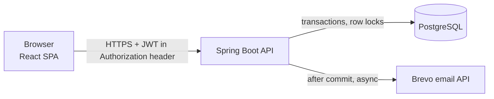

# Joinlist

**Event sign-ups with a fixed number of seats, an automatic waitlist, and QR check-in.**

Student clubs and workshop organisers usually collect sign-ups with Google Forms, which can't cap
attendance, can't move people off a waitlist, and turns door check-in into a paper list. Joinlist fixes that:

- An organiser creates an event with *N* seats and a registration window, then shares the link.
- When registration opens, the first *N* people get a seat. Everyone after that joins the waitlist in order.
- If someone cancels, the first person on the waitlist gets the seat automatically and is emailed.
- Each confirmed person gets a QR code. The organiser scans it at the door; a code works only once.

The interesting part is the backend: **many people clicking "Register" at the same moment must never get
more seats than exist**, and a freed seat must never sit empty while someone is waiting.

## Tech

| Part | Choice |
|---|---|
| Backend | Java 21, Spring Boot 4.1, Spring Security (JWT), plain SQL with `JdbcClient`, Flyway |
| Database | PostgreSQL 17 |
| Frontend | React 19, TypeScript, Vite, Tailwind CSS |
| Tests | JUnit 5, Testcontainers (real PostgreSQL), MockMvc, k6 load test |
| CI | GitHub Actions: backend tests + frontend build on every push |
| Hosting (free tiers) | Cloudflare Pages (frontend), Render (backend, Docker), Supabase (PostgreSQL), Brevo (email API) |



## How overbooking is prevented

Three layers, from strongest to friendliest:

1. **The database refuses bad data.**
   `CHECK (confirmed_count <= capacity)` on `events`, and a partial unique index
   `UNIQUE (event_id, user_id) WHERE status <> 'CANCELLED'` on `registrations`.
   Even buggy Java code can't overbook or double-register.
2. **Taking a seat is atomic.** The seat counter and the registration row change in one transaction.
3. **Freeing a seat hands it over.** Cancelling (or raising capacity) locks the event row and moves the
   first waitlisted person to `CONFIRMED` in the same transaction. The counter only goes down if nobody is waiting.
   So "seats free" and "people waiting" are never true at the same time.

All seat changes lock the event row *before* any registration row, so locks are always taken in the same
order and can't deadlock.

### Two ways to take a seat (switchable with `SEAT_STRATEGY`)

**A. Conditional atomic update** (`atomic`, default)

```sql
UPDATE events SET confirmed_count = confirmed_count + 1
WHERE id = ? AND status = 'PUBLISHED'
  AND now() >= registration_opens_at AND now() < registration_closes_at
  AND confirmed_count < capacity
```

One row updated means you got a seat. Zero rows means full or closed. Then it falls back to the locked path
so a concurrent cancellation can't free a seat between "it's full" and "join the waitlist".

**B. Pessimistic lock** (`pessimistic`)

```sql
SELECT * FROM events WHERE id = ? FOR UPDATE   -- everyone else for this event waits here
-- check the window and the count, then UPDATE ... + 1
```

Easier to reason about. Requests for the same event queue up behind the lock.

## Results

### Concurrency tests (JUnit + real PostgreSQL), run for both strategies

| Test | Checks |
|---|---|
| 1000 people race for 50 seats | exactly 50 `CONFIRMED`, 950 `WAITLISTED`; counter = rows |
| 2 people race for the last seat | one gets it, one waits |
| One person double-clicks 20 times | exactly 1 registration |
| 25 cancellations + 40 new registrations at once | no empty seat while people wait; counter = rows |

Plus rules tests (waitlist order, capacity changes, cancel cut-off, check-in once, forged QR codes) and an
HTTP flow test (sign-up → publish → register → waitlist → check-in → permissions). **22 tests, all passing.**

### Load test (k6, over HTTP)

1000 separate accounts, each sending one registration request at the same moment, for a 50-seat event.
Afterwards the script asks the server what it actually stored.

Measured on 17 Oct 2026 on one Windows 11 laptop (API, PostgreSQL 17 and k6 all on the same machine,
DB pool of 10 connections). Timings are for the registration requests only.

| Strategy | Runs | Warm runs with 0 errors | p50 | p90 | p95 |
|---|---|---|---|---|---|
| Atomic update | 3 | 3 of 3 | 486–631 ms | 651–866 ms | 656–868 ms |
| Pessimistic lock | 7 | 4 of 4 | 420–470 ms | 597–794 ms | 615–797 ms |

(Timings are from the warm runs that recorded per-request stats: 2 atomic, 4 pessimistic.)

What this shows, and what it doesn't:

- **Correctness held in all 10 runs**: exactly 50 confirmed, never more, and the counter always matched
  the rows. In warm runs the other 950 were all on the waitlist.
- In 3 runs on a **cold** server (right after start-up), Windows refused 8–95 of the 1000 simultaneous
  TCP connections (`connectex: ... actively refused`). The app logged no errors and the seats were still
  correct; those requests never reached it, so those people simply weren't registered. A larger Tomcat
  `accept-count` didn't help, which points at the OS connection queue on Windows 11 Home.
- On this setup the two strategies are about equally fast. Once the event is full, the atomic path does an
  extra query (try the update, then lock), so it has no advantage when 95% of requests end on the waitlist.
- This is a laptop, not the free Render instance. It's not a production benchmark.

Raw k6 summaries: `loadtest/results/` (not committed, re-run to reproduce).

## Run it locally

**With Docker**

```bash
docker compose up --build          # API on :8080, PostgreSQL on :5432
cd frontend && npm install && npm run dev   # http://localhost:5173
```

**Without Docker** (your own PostgreSQL with a `joinlist` database and user)

```bash
cd backend && ./mvnw spring-boot:run
```

**Tests**

```bash
cd backend && ./mvnw verify      # needs Docker for Testcontainers
# no Docker? point the tests at your own PostgreSQL:
./mvnw verify -Dtest.local-db=true -Dspring.datasource.url=jdbc:postgresql://localhost:5432/joinlist_test
```

**Load test** (API must run with `RATE_LIMIT_ENABLED=false`; docker compose does this)

```bash
k6 run loadtest/race.js
SEAT_STRATEGY=pessimistic docker compose up --build   # then run k6 again to compare
```

## Configuration

| Variable | Meaning |
|---|---|
| `DATABASE_URL`, `DATABASE_USERNAME`, `DATABASE_PASSWORD` | PostgreSQL (`jdbc:postgresql://...`) |
| `JOINLIST_SECRET` | 32+ random characters; signs login tokens and QR codes |
| `CORS_ORIGINS` | Frontend URL(s), comma-separated |
| `SEAT_STRATEGY` | `atomic` (default) or `pessimistic` |
| `RATE_LIMIT_ENABLED` | `true` by default |
| `BREVO_API_KEY`, `BREVO_SENDER_EMAIL` | Email. Without a key, emails are only logged |
| `APP_URL` | Frontend URL used in email links |
| `VITE_API_URL` (frontend) | Backend URL |

## Security notes

- Passwords are stored as BCrypt hashes. Login answers "wrong email or password" either way.
- Login tokens are sent in the `Authorization` header, not cookies (the frontend and API are on different
  sites, and Safari blocks cross-site cookies). No cookies means no CSRF.
- QR codes are `registrationId.HMAC(secret)`, so they can't be forged or guessed, and they can be shown again
  without being stored. Check-in is a single conditional `UPDATE`, so a code works once.
- Every organiser action checks ownership on the server.
- CSV export neutralises cells starting with `= + - @` (spreadsheet formula injection).
- Simple per-minute rate limits: sign-up/login per IP, other actions per account.

## Known limits (v1)

- Rate limits live in one server's memory. With several servers they'd need Redis.
- Failed emails are logged, not retried. A transactional outbox would fix that.
- No email verification, so one person can make several accounts.
- The free Render instance sleeps after 15 minutes idle; the first request then takes about a minute.
- Personal data is kept 12 months as a policy; automatic deletion isn't built yet.

## What I'd do next

Redis-backed rate limiting, an outbox table with retries for email, email verification, a time limit for
promoted waitlisters to confirm, and running the load test on Linux / the deployed stack.
